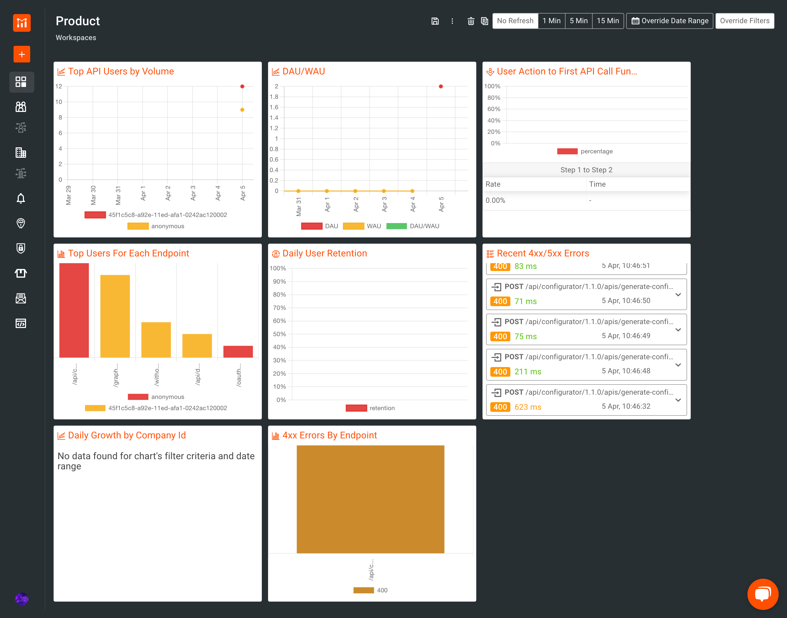

# Configure Analytics for Moesif

<Steps>

## Get Collector Application Id {/* #step-1---get-collector-application-id */}

1. Sign up for [Moesif](https://www.moesif.com/).

2. During the sign up process, you will receive a Collector Application Id for your configured application. Copy this value and keep it saved.

## Configure APK {/* #step-2---configure-apk */}

1. Create a secret containing the Moesif Collector Application ID using the following command. Replace the ```moesif-collector-application-id``` with your Collector Application ID.
    
    <Tabs>
    <TabItem value="tab-0" label="Sample Command">

    ```bash
    kubectl create secret generic moesif-secret --from-literal=moesifToken='<moesif-collector-application-id>' -n apk
    ```

    </TabItem>
    <TabItem value="tab-1" label="Command Format">

    ```bash
    kubectl create secret generic <secret-name> --from-literal=moesifToken='<moesif-collector-application-id>' -n <namespace>
    ```

    </TabItem>
    </Tabs>

2. Follow the instructions outlined in the <a href="../../../setup/Customize-Configurations" target="_blank">customize configurations section</a>. These instructions will guide you through the process of acquiring the `values.yaml` file.
   
3. Replace ```secret-name``` in the following configuration with the name of the secret you created in the previous step.

```yaml
analytics:
 enabled: true
 publishers:
 - enabled: true
   type: "moesif"
   secretName: <secret-name>
```

4. Open the `values.yaml` file, and add the above configuration to the `gatewayRuntime` section under `dp`. Your values.yaml file should have a structure as follows:
   
```yaml
wso2:
  ...
  apk:
    ...
    dp:
      ...
      gatewayRuntime:
        analytics:
          enabled: true
          publishers:
          - enabled: true
            type: "moesif"
            secretName: <secret-name>
```
5. Then redeploy the helm chart with the changes in `values.yaml`.

### Optional - Adding Multiple Publishers

You can also set multiple publishers for analytics as follows. Replace `choreo-secret-name` and `moesif-secret-name` with the appropriate values.

```yaml
gatewayRuntime:
  analytics:
    enabled: true
    publishers:
      - enabled: true
        type: "default"
        secretName: <choreo-secret-name>
      - enabled: true
        type: "elk"
      - enabled: true
        type: "moesif"
        secretName: <moesif-secret-name>
```
## View Analytics Data {/* #step-3---view-analytics-data */}

1. After setting up the enforcer, invoke a few requests (success and failure) for a deployed API.

2. Go to your Moesif dashboard and you will be able to view your analytics reports.

The following is an overview of the graphs generated in the Moesif Dashboards.

[](../../../assets/img/analytics/moesif-dashboards-overview.png)

</Steps>
