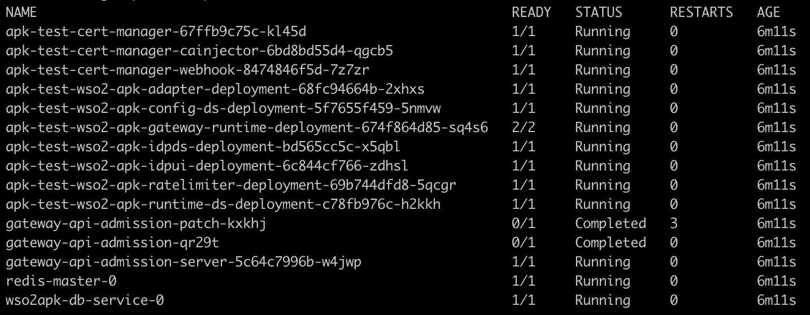

Follow the instructions below to deploy APK Data Service (DS) servers and the Cloud Native Postgres(CloudNativePG) in the Kubernetes cluster.

### Open Source Approach  

1. Create a new helm repository with the latest apk release using the following command. Let’s consider the ```<repository-name>``` as ```wso2apk``` for this guide.

    ```console
    helm repo add wso2apk https://github.com/wso2/apk/releases/download/1.0.0
    ```

2. Execute the following command to update the helm repositories.

    ```console
    helm repo update
    ```
   
3. Install the APK components and start WSO2 API Platform For Kubernetes. Consider ```apk``` as the ```<chart-name>``` for this guide. As the ```--version``` of this command, use the version of the release you used in point 1 above. It will take a few minutes for the deployment to complete.

<Tabs>
<TabItem value="tab-0" label="Command">

```
helm install apk wso2apk/apk-helm --version 1.0.0
```

</TabItem>
<TabItem value="tab-1" label="Format">

```
helm install <chart-name> <repository-name>/apk-helm --version <version-of-APK>
```

</TabItem>
</Tabs>

!!!Optional
    To commence the installation while making use of the customization capabilities inherent in the `values.yaml` file, follow the subsequent command format. Instructions in [Customize Configurations](../setup/Customize-Configurations.mdx) will guide you through the process of acquiring the `values.yaml` file.
    <Tabs>
    <TabItem value="tab-0" label="Command">

    ```
     helm install apk wso2apk/apk-helm --version 1.0.0 -f values.yaml
    ```

    </TabItem>
    <TabItem value="tab-1" label="Format">

    ```
    helm install <chart-name> <repository-name>/apk-helm --version <version-of-APK> -f <path-to-values.yaml-file>
    ```

    </TabItem>
    </Tabs>

### Enterprise Approach

1.  Create WSO2 APK image pull secrets with your WSO2 credentials as shown below and apply
this in K8s.

    ```console
    kubectl create secret docker-registry apk-registry-secret --docker-server=docker.wso2.com --docker-username=<username> --docker-password=<password> --docker-email=<email>
    ```

    !!!Note
        If you don't have a WSO2 user account, we've created one and sent you the details. If you already have an account, just use your existing credentials.

2. Add the WSO2 APK Helm repository.

    ```console
    helm repo add wso2 https://helm.wso2.com
    ```
	
3. Execute the following command to update the helm repositories.

      ```console
      helm repo update
      ```

3. Install the APK components and start WSO2 API Platform For Kubernetes. Consider ```apk``` as the ```<chart-name>``` for this guide. As the ```--version``` of this command, use the version of the release you used in point 1 above. It will take a few minutes for the deployment to complete.

    #### Helm install for amd64

    <Tabs>
    <TabItem value="tab-0" label="Command">

    ```
    helm install apk wso2/apk-helm --version 1.0.0 --set wso2.subscription.imagePullSecrets="apk-registry-secret"
    ```

    </TabItem>
    <TabItem value="tab-1" label="Format">

    ```
    helm install <chart-name> <repository-name>/apk-helm --version <version-of-APK> --set wso2.subscription.imagePullSecrets=<secret-name>
    ```

    </TabItem>
    </Tabs>
	
    #### Helm install for arm64

    <Tabs>
    <TabItem value="tab-0" label="Command">

    ```
    helm install apk wso2/apk-helm --version 1.0.0 --set wso2.subscription.imagePullSecrets="apk-registry-secret" -f https://raw.githubusercontent.com/wso2/apk/main/helm-charts/sample/arm64.yaml
    ```

    </TabItem>
    <TabItem value="tab-1" label="Format">

    ```
    helm install <chart-name> <repository-name>/apk-helm --version <version-of-APK> -f <path-to-arm64.yaml-file>
    ```

    </TabItem>
    </Tabs>

    !!!Optional
    
        To commence the installation while making use of the customization       capabilities inherent in the `values.yaml` file, follow the subsequent command format. Instructions in [Customize Configurations](../setup/Customize-Configurations.mdx) will guide you through the process of acquiring the `values.yaml` file.
        <Tabs>
        <TabItem value="tab-0" label="Command">

        ```
        helm install apk wso2apk/apk-helm --version 1.0.0 -set wso2.subscription.imagePullSecrets="apk-registry-secret" -f values.yaml
        ```

        </TabItem>
        <TabItem value="tab-1" label="Format">

        ```
        helm install <chart-name> <repository-name>/apk-helm --version <version-of-APK> --set wso2.subscription.imagePullSecrets=<secret-name> -f <path-to-values.yaml-file> 
        ```

        </TabItem>
        </Tabs>

### Verify the deployment

Now you can verify the deployment by executing the following command. You will see the status of the pods as follows once completed.

<Tabs>
<TabItem value="tab-0" label="Command">

```
kubectl get pods
```

[](../../../assets/img/get-started/podstatus.png)

:::warning

If pods are not transitioning to running state, please follow the steps in the [FAQs](../../about-apk/FAQs/#q3-why-are-pods-not-transitioning-to-the-running-state-for-a-long-time) to troubleshoot the problem.

:::

</TabItem>
</Tabs>
