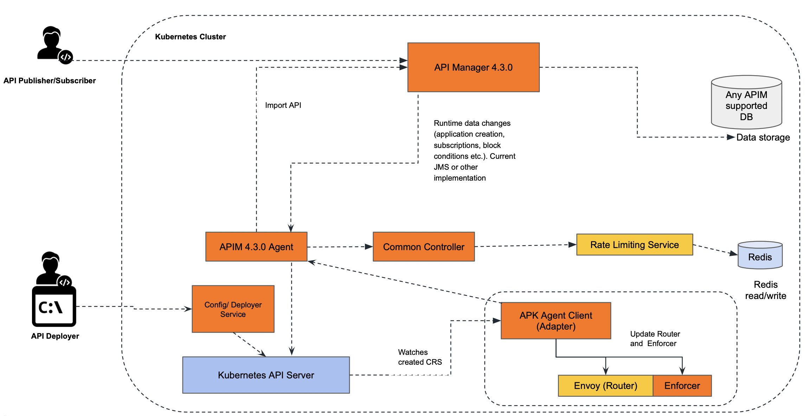
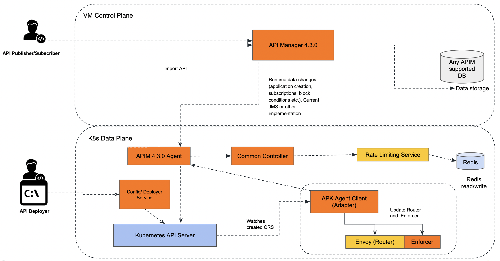

# APK Data Plane with API Manager Control Plane Deployment Patterns

This document outlines the recommended deployment patterns for the WSO2 APK Data Plane with API Manager Control Plane. There are two primary deployment patterns for WSO2 APK Data Plane with API Manager Control Plane.

* [Data Plane and Control Plane both in Kubernetes cluster](#data-plane-and-control-plane-both-in-kubernetes-cluster)
* [Data Plane in Kubernetes cluster and Control Plane in a VM](#data-plane-in-kubernetes-cluster-and-control-plane-in-a-vm)

## Data Plane and Control Plane both in Kubernetes cluster

### Overview

In this approach, both APK Dataplane and APIM are in a single kubernetes cluster. In this pattern APK dataplane will have visibility over all the namespace (or a predefined set of namespaces) in the cluster.

### Architecture diagram

[](../../../../assets/_versions/1.1.0/img/deployment-patterns/APK_DP_TO_CP_K8s.png)

### Advantages

* Resource Efficiency: This pattern maximizes resource utilization by allowing multiple components to coexist within the same cluster.
* Simplified Management: Managing a single cluster with multiple namespaces can be more straightforward compared to managing separate clusters.

### Considerations

* Isolation: While namespaces provide a level of isolation, they may not offer the same level of isolation as separate clusters. Careful resource allocation and RBAC (Role-Based Access Control) policies are essential.
* APIM in K8s: Running APIM in a Kubernetes cluster may require additional resources and configurations compared to running it in a VM.

### Deployment guideline

By default, WSO2 APK is configured to support the Data Plane Only Pattern. You can follow the below steps to do the deployment using this pattern.


#### Create Kubernetes namespace

```
kubectl create ns apk
```

#### Configure the hosts file

Add a hostname mapping to the ```/etc/hosts``` file as follows.

| IP        | Domain name         |
| --------- | ------------------- |
| 127.0.0.1 | api.am.wso2.com     |
| 127.0.0.1 | am.wso2.com         |
| 127.0.0.1 | idp.am.wso2.com     |
| 127.0.0.1 | default.gw.wso2.com |

#### Setup WSO2 API Manager Control Plane 4.3.0

Setup WSO2 API Manager 4.3.0 in K8s cluster using Helm Charts.

1. Create a new helm repository with the latest apim release using the following command. Let’s consider the ```<repository-name>``` as ```wso2apim```.

    ```console
    helm repo add wso2apim https://github.com/wso2/helm-apim/releases/download/cp-4.3.0
    ```

2. Execute the following command to update the helm repositories.

    ```console
    helm repo update
    ```

3. Consider ```apim``` as the ```<chart-name>``` for this guide. As the ```--version``` of this command, use the version of the release you used in point 1 above. It will take a few minutes for the deployment to complete.

    <Tabs>
    <TabItem value="tab-0" label="Command">

    ```
    helm install apim wso2apim/wso2am-cp --version 4.3.0 -f https://raw.githubusercontent.com/wso2/apk/main/helm-charts/samples/apim/cp/apk-cp/values.yaml -n apk
    ```

    </TabItem>
    <TabItem value="tab-1" label="Format">

    ```
    helm install <chart-name> <repository-name>/wso2am-cp --version <version-of-APIM> -f <path-to-values.yaml-file>
    ```

    </TabItem>
    </Tabs>

4. Install NGINX Ingress Controller. Please refer to the <a href="https://kubernetes.github.io/ingress-nginx/deploy/#local-development-clusters" target="_blank">NGINX Ingress Controller</a> documentation for more information.

:::note

Please refer to the <a href="../../control-plane/apim-deploy/" target="_blank">Advanced Configuration for APIM</a> for more information.

:::

#### Setup WSO2 APK Dataplane 1.1.0

1. Create a new helm repository with the latest apk release using the following command. Let’s consider the ```<repository-name>``` as ```wso2apk```.

    ```console
    helm repo add wso2apk https://github.com/wso2/apk/releases/download/1.1.0
    ```

2. Execute the following command to update the helm repositories.

    ```console
    helm repo update
    ```

3. Install the APK components and start WSO2 API Platform For Kubernetes. Consider ```apk``` as the ```<chart-name>``` for this guide. As the ```--version``` of this command, use the version of the release you used in point 1 above. It will take a few minutes for the deployment to complete.

    <Tabs>
    <TabItem value="tab-0" label="Command">

    ```
    helm install apk wso2apk/apk-helm --version 1.1.0 -f https://raw.githubusercontent.com/wso2/apk/main/helm-charts/samples/apk/values.yaml -n apk
    ```

    </TabItem>
    <TabItem value="tab-1" label="Format">

    ```
    helm install <chart-name> <repository-name>/apk-helm --version <version-of-APK> -f <path-to-values.yaml-file>
    ```

    </TabItem>
    </Tabs>

:::note

If you wish to change the default hostname and vhost change the following values.yaml configurations. Lets say you want to deploy a production environment and you have a domain name example.com and you want to expose your API's through prod.gw.example.com and expose APK system APIs through prod.apk.example.com then
   
- wso2.apk.listener.hostname: 'prod.apk.example.com'
- wso2.apk.dp.gateway.listener.hostname: 'gw.example.com'
- wso2.apk.dp.configdeployer.vhosts: [\{"hosts":["gw.example.com"],"name":"prod","type":"production"\}]

:::

:::note

If you wish to specify a predefined set of namespaces for monitoring, you can configure the `wso2.apk.dp.adapter.configs.apiNamespaces` variable in the `values.yaml` file. For example, if you want the dataplane to monitor only the `ns-1` and `ns-2` namespaces, you can set it as follows:
```yaml
Wso2:
  apk:
    dp:
      adapter:
        configs:
          apiNamespaces:
          - "ns-1"
          - "ns-2"
      commonController:
        configs:
          apiNamespaces:
          - "ns-1"
          - "ns-2"
```

:::

:::note

Please refer to the <a href="../../control-plane/apk-deploy/" target="_blank">Advanced Configuration for APK</a> for more information.

:::


#### Setup WSO2 APIM-APK Agent 1.1.0

1. Create a new helm repository with the latest apim apk agent release using the following command. Let’s consider the ```<repository-name>``` as ```wso2apkagent``` for this guide.

    ```console
    helm repo add wso2apkagent https://github.com/wso2/product-apim-tooling/releases/download/1.1.0
    ```

2. Execute the following command to update the helm repositories.

    ```console
    helm repo update
    ```

3. Install the APIM APK Agent components and start WSO2 API Platform For Kubernetes. Consider ```apk``` as the ```<chart-name>``` for this guide. As the ```--version``` of this command, use the version of the release you used in point 1 above. It will take a few minutes for the deployment to complete.

    <Tabs>
    <TabItem value="tab-0" label="Command">

    ```
    helm install apim-apk-agent wso2apkagent/apim-apk-agent --version 1.1.0 -f https://raw.githubusercontent.com/wso2/apk/main/helm-charts/samples/apim-apk-agent/cp/values.yaml -n apk
    ```

    </TabItem>
    <TabItem value="tab-1" label="Format">

    ```
    helm install <chart-name> <repository-name>/apim-apk-agent --version <version-of-APK-Agent> -f <path-to-values.yaml-file>
    ```

    </TabItem>
    </Tabs>

:::note

Please refer to the <a href="../../control-plane/apim-apk-agent-deploy/" target="_blank">Advanced Configuration for Agent</a> for more information.

:::

#### Verify the deployment

Now you can verify the deployment by executing the following command. You will see the status of the pods as follows once completed.

<Tabs>
<TabItem value="tab-0" label="Command">


</TabItem>
</Tabs>
```
kubectl get pods -n apk
```


This approach is recommended for all Production, Dev, Test, and UAT environments. Here a seperate kubernetes cluster is required for each environment.


## Data Plane in Kubernetes cluster and Control Plane in a VM

### Overview

In this approach, APK Dataplane is deployed in a kubernetes cluster and APIM in Virtual Machine. In this pattern APK dataplane will have visibility over all the namespace (or a predefined set of namespaces) in the cluster.

### Architecture diagram

[](../../../../assets/_versions/1.1.0/img/deployment-patterns/APK_DP_TO_CP_VMs.png)

### Advantages

* Isolation: APK Dataplane operates in its own dedicated kubernetes cluster, while APIM CP in a VM, providing the highest level of isolation and minimizing the risk of interference between components.
* Security: With separate cluster and VM setup it's easier to implement stringent security policies specific to each component.
* Performance Predictability: Resources are exclusively allocated to each cluster, guaranteeing consistent performance levels.

### Considerations

* Resource Utilization: This approach may require additional resources due to the need for separate cluster and VM for each environment.
* Administrative Overhead: Managing multiple cluster and VMs can be more complex and may require additional administrative effort.

### Deployment guideline

By default, WSO2 APK is configured to support the Data Plane Only Pattern. You can follow the below steps to do the deployment using this pattern.


#### Create Kubernetes namespace

```
kubectl create ns apk
```

#### Configure the hosts file

Add a hostname mapping to the ```/etc/hosts``` file as follows.

| IP        | Domain name         |
| --------- | ------------------- |
| 127.0.0.1 | api.am.wso2.com     |
| 127.0.0.1 | am.wso2.com         |
| 127.0.0.1 | idp.am.wso2.com     |
| 127.0.0.1 | default.gw.wso2.com |

#### Setup WSO2 API Manager Control Plane 4.3.0

Setup WSO2 API Manager 4.3.0 in VM.

1. Refer to the [APIM Deployment Guide](https://apim.docs.wso2.com/en/latest/install-and-setup/install/installation-options/#2-dockerdocker-compose) to deploy the APIM 4.3.0 in a VM.
2. Change the configurations in the ```deployment.toml``` file in the APIM 4.3.0 VM refer to the [Advance Configuration for APIM](../../../control-plane/apim-deploy/) for more information.


#### Setup WSO2 APK Dataplane 1.1.0

1. Create a new helm repository with the latest apk release using the following command. Let’s consider the ```<repository-name>``` as ```wso2apk```.

    ```console
    helm repo add wso2apk https://github.com/wso2/apk/releases/download/1.1.0
    ```

2. Execute the following command to update the helm repositories.

    ```console
    helm repo update
    ```

3. Install the APK components and start WSO2 API Platform For Kubernetes. Consider ```apk``` as the ```<chart-name>``` for this guide. As the ```--version``` of this command, use the version of the release you used in point 1 above. It will take a few minutes for the deployment to complete.

    <Tabs>
    <TabItem value="tab-0" label="Command">

    ```
    helm install apk wso2apk/apk-helm --version 1.1.0 -f https://raw.githubusercontent.com/wso2/apk/main/helm-charts/samples/apk/values.yaml -n apk
    ```

    </TabItem>
    <TabItem value="tab-1" label="Format">

    ```
    helm install <chart-name> <repository-name>/apk-helm --version <version-of-APK> -f <path-to-values.yaml-file>
    ```

    </TabItem>
    </Tabs>

:::note

You can change the default hostname and vhost. Change the following values.yaml configurations. Lets say you want to deploy a development environment and you have a domain name example.com and you want to expose your API's through dev.gw.example.com and expose APK system APIs through dev.apk.example.com then

- wso2.apk.listener.hostname: 'dev.apk.example.com'
- wso2.apk.dp.gateway.listener.hostname: 'dev.gw.example.com'
- wso2.apk.dp.configdeployer.vhosts: [\{"hosts":["gw.example.com"],"name":"dev","type":"production"\}]

:::

:::note

Please refer to the [Advance Configuration for APK](../../../control-plane/apk-deploy) for more information.

:::


#### Setup WSO2 APIM-APK Agent 1.1.0

1. Create a new helm repository with the latest apim apk agent release using the following command. Let’s consider the ```<repository-name>``` as ```wso2apkagent``` for this guide.

    ```console
    helm repo add wso2apkagent https://github.com/wso2/product-apim-tooling/releases/download/1.1.0
    ```

2. Execute the following command to update the helm repositories.

    ```console
    helm repo update
    ```

3. Change the configurations in the ```values.yaml``` file in the APIM APK Agent Helm Chart, refer to the [Advance Configuration for agent](../../../control-plane/apim-apk-agent-deploy) for more information.

4. Install the APIM APK Agent components and start WSO2 API Platform For Kubernetes. Consider ```apk``` as the ```<chart-name>``` for this guide. As the ```--version``` of this command, use the version of the release you used in point 1 above and use the changed values.yaml you used in point 3 above. It will take a few minutes for the deployment to complete.

    <Tabs>
    <TabItem value="tab-0" label="Command">

    ```
    helm install apim-apk-agent wso2apkagent/apim-apk-agent --version 1.1.0 -f https://raw.githubusercontent.com/wso2/apk/main/helm-charts/samples/apim-apk-agent/cp/values.yaml -n apk
    ```

    </TabItem>
    <TabItem value="tab-1" label="Format">

    ```
    helm install <chart-name> <repository-name>/apim-apk-agent --version <version-of-APK-Agent> -f <path-to-values.yaml-file>
    ```

    </TabItem>
    </Tabs>

#### Verify the deployment

Now you can verify the deployment by executing the following command. You will see the status of the pods as follows once completed.

<Tabs>
<TabItem value="tab-0" label="Command">


</TabItem>
</Tabs>
```
kubectl get pods -n apk
```


This approach is recommended for all Production, Dev, Test, and UAT environments. Here a seperate kubernetes cluster and a VM server is required for each environment.
