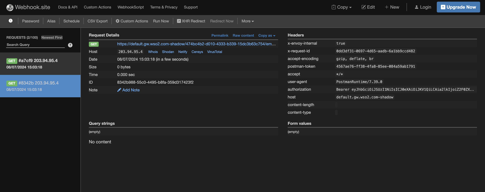

# Mirroring Requests via CRs

This functionality enables request mirroring, where a request can be duplicated and sent to multiple backends for testing and monitoring. This guide explains how to enable request mirroring via Kubernetes CRs.

<Steps>

### Get the CRs for the relevant API configuration {/* #step-1---get-the-crs-for-the-relevant-api-configuration */}

Here, you can follow the steps in <a href="../../../../create-api/create-and-deploy-apis/rest/create-rest-api-using-crs" target="_blank">Develop and Deploy a REST API via CRs</a> documentation and create the CRs to deploy an API from scratch. 

Alternatively, you can generate the CRs for a given apk-conf file using the steps as detailed in <a href="../../../../api-management-overview/tools-for-api-development#option-2-generate-k8s-custom-resources-using-config-generator-tool-and-deploy-the-api-using-kubernetes-client" target="_blank">this section</a>.

### Add the header modification filters to the HTTPRoute CR {/* #step-2---add-the-header-modification-filters-to-the-httproute-cr */}

Header modification can be done using an HTTPRoute filter as follows.

First, create the relevant Backend CR to mirror the request to. A sample Backend CR is provided below.

```
apiVersion: "dp.wso2.com/v1alpha1"
kind: "Backend"
metadata:
  name: "mirror-backend"
spec:
  services:
    - host: "webhook.site"
      port: 443
  basePath: "/30cd1472-d4ac-4440-ab8d-66fc0a789c7b"
  protocol: "https"
```

Then you can refer to this CR in your HTTPRoute CR as follows.

```
filters:
  - type: "RequestMirror"
    requestMirror:
      backendRef:
        group: "dp.wso2.com"
        kind: "Backend"
        name: "mirror-backend"
```

The complete sample HTTPRoute is as follows.

```
apiVersion: "gateway.networking.k8s.io/v1beta1"
kind: "HTTPRoute"
metadata:
  name: "production-httproute"
spec:
  hostnames:
  - "default.gw.wso2.com"
  rules:
  - matches:
    - path:
        type: "RegularExpression"
        value: "/employee"
      method: "GET"
    filters:
    - type: "RequestMirror"
      requestMirror:
        backendRef:
          group: "dp.wso2.com"
          kind: "Backend"
          name: "mirror-backend"
  parentRefs:
  - group: "gateway.networking.k8s.io"
    kind: "Gateway"
    name: "wso2-apk-default"
    sectionName: "httpslistener"
```

This policy mirrors the request to the production/sandbox endpoint, as well as the relevant mirror URL.

### Deploy the API in APK {/* #step-3---deploy-the-api-in-apk */}

You can deploy the API using the following command. Replace &lt;namespace> with the correct namespace.
```
kubectl apply -f . -n <namespace>
```

### Generate an access token {/* #step-4---generate-an-access-token */}

Follow the [Generate Access Token](../../../develop-and-deploy-api/security/generate-access-token.mdx) documentation to generate an access token.

### Invoke the API {/* #step-5---invoke-the-api */}

You can invoke the API using the following command.

```
curl --location 'https://default.gw.wso2.com:9095/employee/1.0/employee' \
--header 'Host: default.gw.wso2.com' \
--header 'Authorization: Bearer <accessToken>
```

Once you have invoked the above, you can view the duplicated requests in the webhook.site page as follows.

[](../../../../../assets/img/api-management/api-policies/webhook-site-request-mirroring.png)

</Steps>
