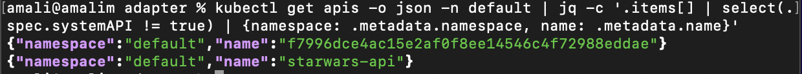

To undeploy an API, you can use the following steps.

<Steps>

### Get the API CR Name {/* #step-1-get-the-api-cr-name */}

Execute the following command to list APIs deployed in your dataplane.

<Tabs>
<TabItem value="tab-0" label="Command Format">

```bash
kubectl get apis -o json -n <namespace> | jq -c '.items[] | select(.spec.systemAPI != true) | {namespace: .metadata.namespace, name: .metadata.name}'
```

</TabItem>
<TabItem value="tab-1" label="Sample Output">

[](../../../assets/img/api-management/select-api.png)

</TabItem>
</Tabs>

### Delete the API CR {/* #step-2-delete-the-api-cr */}

Copy the API CR name that you want to undeploy and execute the following command.

<Tabs>
<TabItem value="tab-0" label="Command Format">

```bash
kubectl delete api <api-name> -n <namespace>
```

</TabItem>
</Tabs>

After deleting the API CR, the API will be undeployed from the dataplane.

</Steps>
